# OGSF · One Generalist Software Fleet

A written request goes in; players (models, run through an agent program such
as [pi](https://github.com/badlogic/pi-mono)) plan and build it, and plain code
decides at every step whether the work may continue. Every match is recorded
on your Mac and can be watched live: on `127.0.0.1` with `ogsf var`, or from
anywhere on **Matchday Live**, deployed to your own Vercel account.

```
ogsf run-heroic "Add a match timer: start, stop, and minutes played on /timer."

 ask → spec → ship_spec → build → test → review → ship_build → changes → document → ship_docs
 founder  playmaker  git   builder   qa   safety officer  git      git      bard       git
```

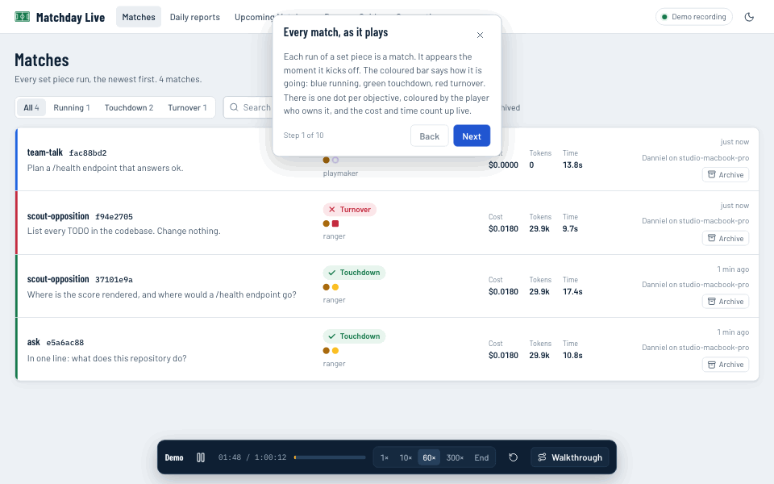

<sub>Matchday Live's demo walkthrough. Every picture on this page is recorded
from the demo (`npm run media` in `docs/diagrams/`), and the demo runs a
**scripted club**: no model is called, no tokens are spent, and every cost
you see is a made-up figure.</sub>

## See it

| A match as it plays | Daily and multi-day reports |
|---|---|
| 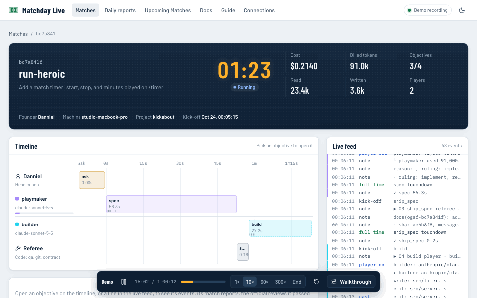 | 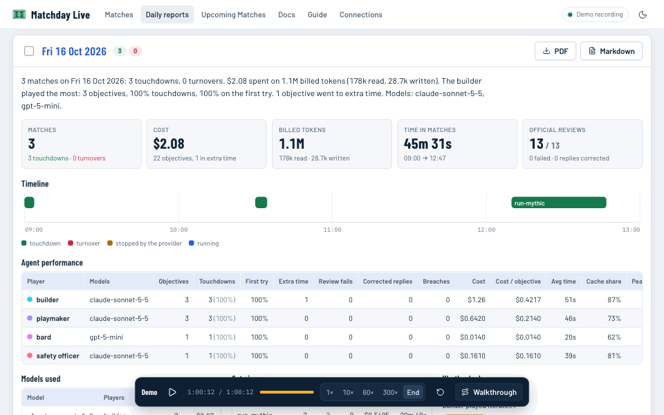 |
| **Upcoming Matches** | **A finished match** |
| 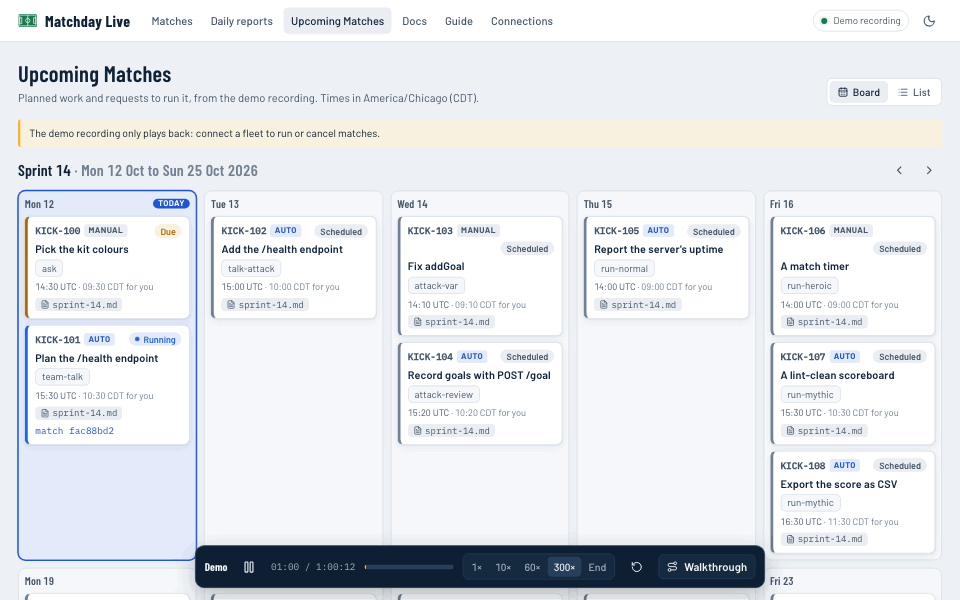 | 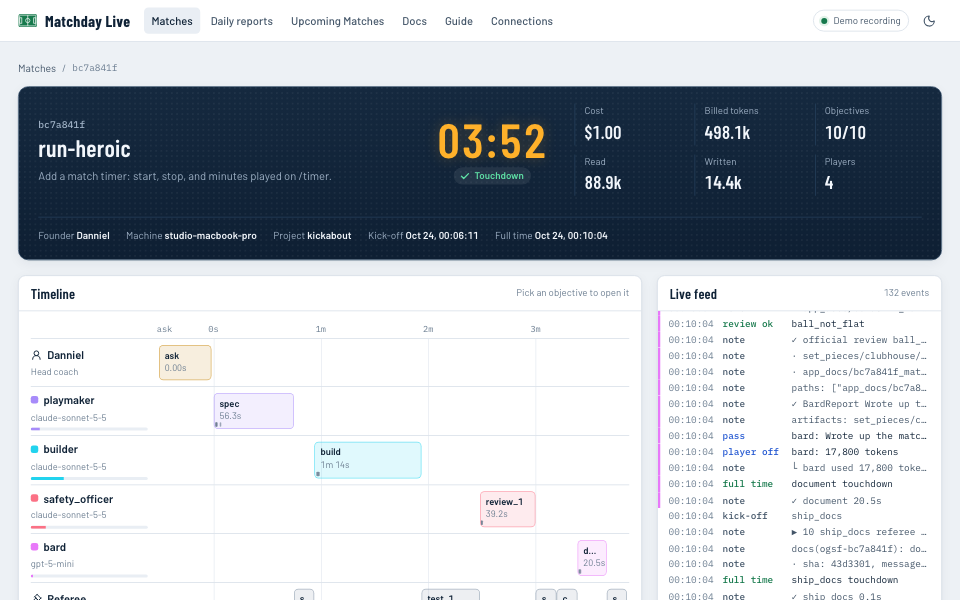 |

Try it yourself, with nothing to set up beyond Go: `make && bin/ogsf demo --serve`.

## How it works

<picture>
  <source media="(prefers-color-scheme: dark)" srcset="docs/diagrams/components.dark.svg">
  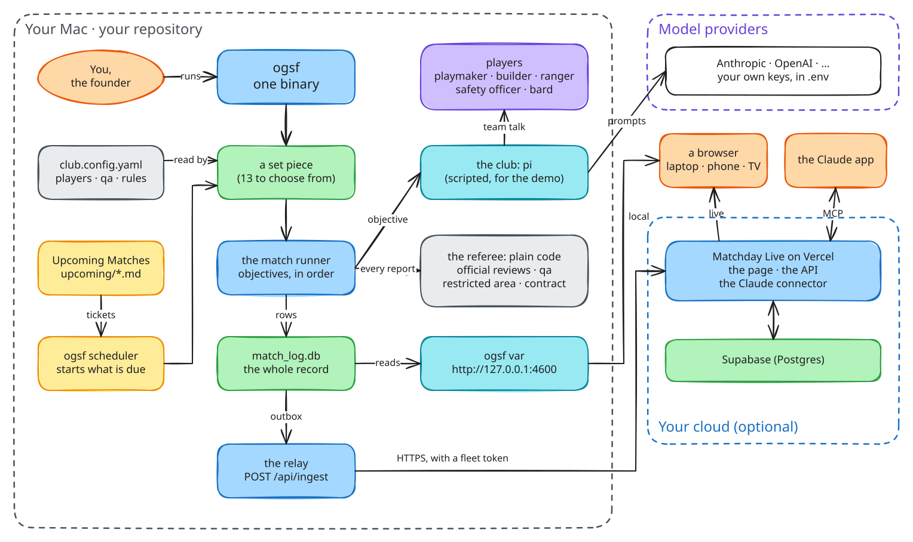
</picture>

Each Mac runs the `ogsf` binary. A set piece is plain Go that runs its
objectives in order; each objective hands one player (a model behind pi)
one prompt, then checks the result: the report must parse, every official
review must pass, and the player may change only the files it is allowed
to. Everything lands in a SQLite match log on that Mac; the relay copies it
to your own cloud store when you set one up.

<picture>
  <source media="(prefers-color-scheme: dark)" srcset="docs/diagrams/match-sequence.dark.svg">
  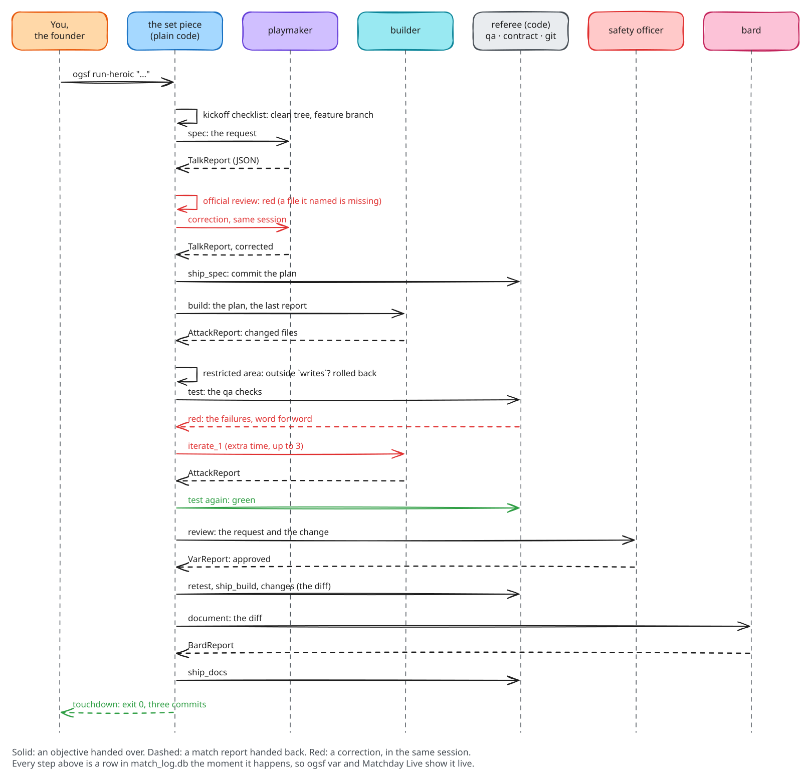
</picture>

The full explanation, with every diagram, is in the [Docs](docs/README.md),
and the step-by-step [Guide](docs/guide/README.md) covers your own
workflows. Both are built into Matchday Live too.

## Credit

OGSF is built on **[Super Simple Software Factory](https://github.com/disler/super-simple-software-factory)
by IndyDevDan** (MIT, copyright 2026 IndyDevDan). The design is his: plain
code owns the order of work, and agents are bounded steps inside it.
Danniel's additions are the kickoff checklist (preflight), the quest contract,
the ruling as a stop, the progressive quality gate, the commit normaliser,
the "match abandoned" provider stop and the spec tools; this Go version adds
Matchday Live, the relay and the scripted club. Renaming things does not
change who designed them.

## Install

Go 1.26 or newer (the module pins the patched Go 1.26.9 toolchain, which `go` downloads by itself):

```sh
go install github.com/dehanz13/one-generalist-software-fleet-mvp1/cmd/ogsf@latest
# or, from a checkout:
make            # tests, then ./bin/ogsf with Matchday Live built in
```

Then, in the repository you want the fleet to work on:

```sh
ogsf incorporate          # set_pieces/: the config, team talks, enchantments; .env.sample; .gitignore
cp .env.sample .env       # set the key(s) your roster needs; .env is never committed
ogsf demo --serve         # every set piece, scripted: no tokens, nothing changed here
```

Players run on **pi** (`club: pi`) with your own provider keys; the fleet
never holds a key. A **scripted** club plays recorded replies for tests and
the demo. `claude_code` is accepted by the config and not implemented yet.

## The set pieces

| Command | Objectives | Accepted when |
|---|---|---|
| `ogsf ask` | ask → answer (any player) | every objective passes |
| `ogsf scout-opposition` | ask → scout_opposition (ranger, read-only) | every objective passes |
| `ogsf team-talk` | ask → spec | every objective passes |
| `ogsf attack` | ask → build | every objective passes |
| `ogsf talk-attack` | ask → spec → build → ship | every objective passes |
| `ogsf attack-var` | ask → build → (test → iterate) ×3 | the suite is green |
| `ogsf attack-review` | ask → build → (review → revise) ×3 | the safety officer approves |
| `ogsf run-normal` | ask → spec → build → (test → iterate) ×3 → ship | the suite is green |
| `ogsf run-heroic` | spec, ship_spec, build, tests, review, retest, ship_build, changes, document, ship_docs | green suite and approval |
| `ogsf run-mythic` | spec → [ruling stop] → benchmark → build → (scope_check → qa → iterate) ×3 → ship | contract clean, progressive gate green |
| `ogsf bard` | ask → changes → document | every objective passes |
| `ogsf qa` | ask → qa (strict) | every check exits 0 |
| `ogsf play <playbook>` | ask → each player in the playbook | every objective passes |

<picture>
  <source media="(prefers-color-scheme: dark)" srcset="docs/diagrams/difficulty-normal-heroic.dark.svg">
  
</picture>

Exit codes: `0` accepted, `1` not accepted (or an error), `2` the kickoff
checklist refused, `75` the provider stopped the match (no review was red),
`128+n` stopped by a signal.

Watch and diagnose: `ogsf matches`, `passages <id>`, `live-feed <id>`,
`on-pitch <id>`, `highlights-match <id>`, `post-match <id>`, `ogsf var`.
Plan and schedule: `upcoming`, `upcoming run <ticket>`, `scheduler`,
`request`, `requests`. Set up: `incorporate`, `onboard`, `write-playbook`,
`demo`. Spec tools: `spec-area`, `spec-types`, `fire-drill`, `shape-search`.
`ogsf <command> --help` explains each.

## Upcoming Matches and the Scheduler

Plan work as markdown in `set_pieces/upcoming/*.md`: one ticket per
heading, each with the day it is to be worked and the set piece that works
it ([the format](templates/set_pieces/upcoming/README.md)).

```sh
ogsf upcoming               # read the sources, update the board, list it
ogsf upcoming run KICK-7    # play one ticket now
ogsf scheduler              # on the Mac that does the work: start auto tickets when due
ogsf request --set-piece ask "Where is the session cookie set?"   # queue a request
```

The Scheduler runs one match at a time and every match passes its kickoff
checklist. An `auto` ticket starts when due, because you wrote it in your
own repository. Requests (from Matchday Live, the Claude connector or
`ogsf request`) run only when the config says `scheduler.accept_remote: true`,
and a request by set piece name only for `scheduler.allowed_set_pieces`
(default: `ask`, `scout-opposition`, `team-talk`). Linear is planned as a
second source.

<picture>
  <source media="(prefers-color-scheme: dark)" srcset="docs/diagrams/upcoming-scheduler.dark.svg">
  
</picture>

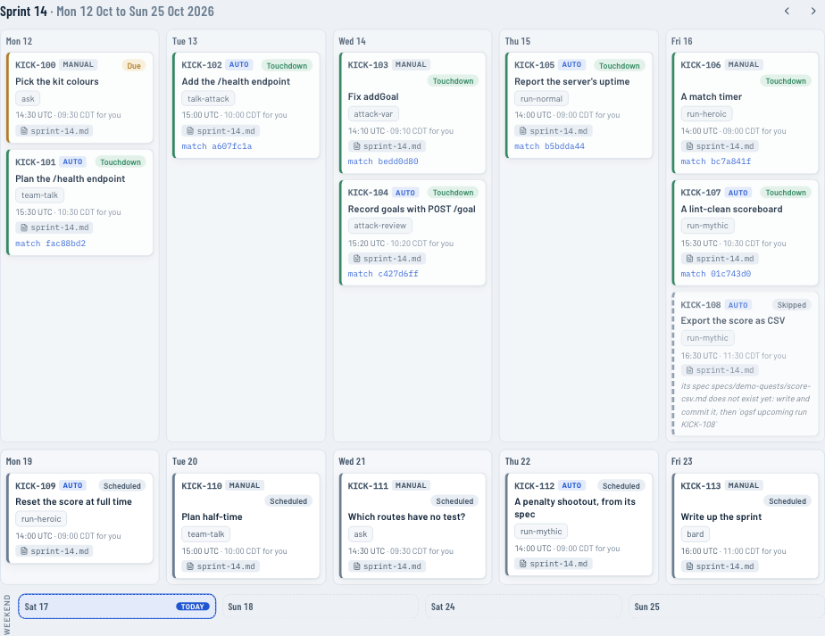

## Reports

Matchday Live groups matches by day. Each day has a report: a summary, the
key figures, a timeline, how each player did, the models and set pieces,
and what is worth a look. Tick several days for a **multi-day report** that
judges every player across them. Both download as Markdown or a colour PDF,
drawn in the browser. The numbers are computed once, in `shared/report.ts`,
from raw facts, so your Mac, the cloud and the Claude connector always
agree.

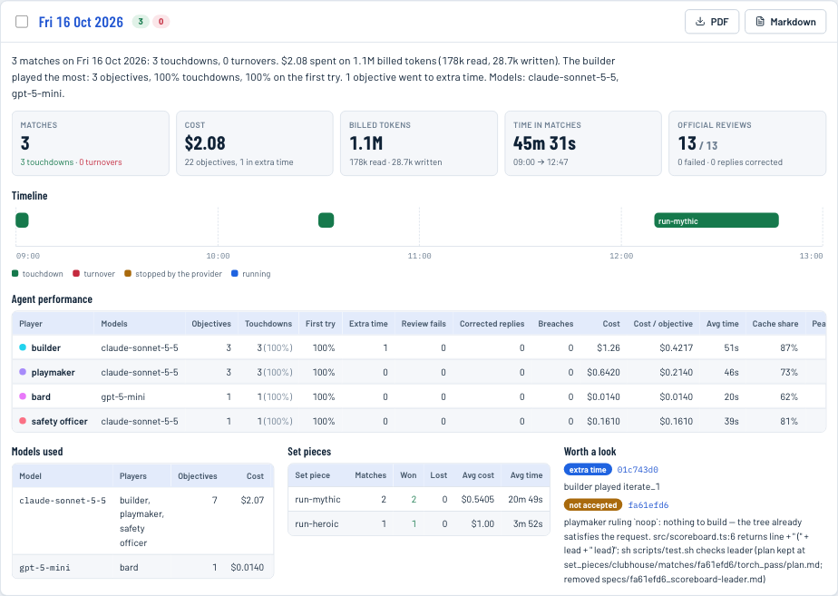

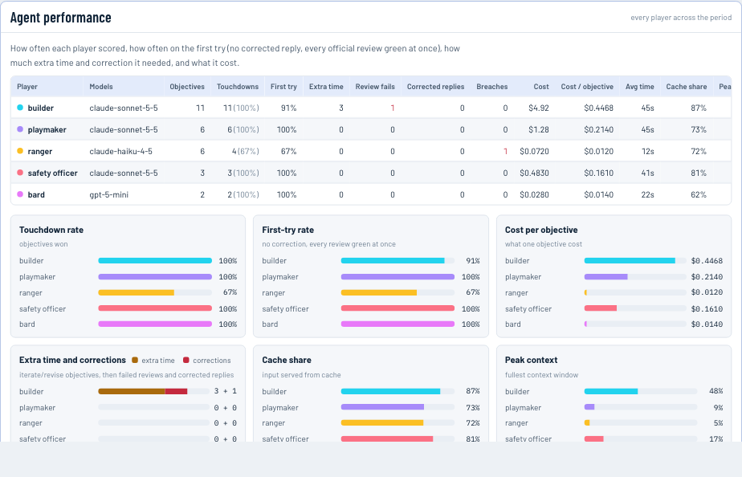

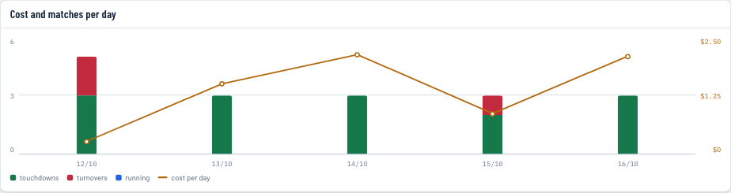

## Matchday Live, from another Mac

1. Deploy `matchday_live/` to Vercel and create a Supabase project
   ([matchday_live/README.md](matchday_live/README.md)). Secrets live only in
   Vercel's environment: `DATABASE_URL`, `MATCHDAY_PASSWORD`,
   `MATCHDAY_SESSION_SECRET`.
2. Sign in, open **Connections**, apply the schema and mint a fleet token for
   each Mac.
3. On each Mac, in the repository's `.env`: `CLUB_RELAY_URL=https://<app>.vercel.app`
   and `CLUB_RELAY_TOKEN=<token>`. Every match then streams to the page as it
   happens; `ogsf relay status` and `ogsf relay push` cover the offline case.

Each Mac keeps its own match log (`set_pieces/clubhouse/match_log.db`); the
cloud is a mirror, so a match never waits on the network.

<picture>
  <source media="(prefers-color-scheme: dark)" srcset="docs/diagrams/matchday-live-data-flow.dark.svg">
  
</picture>

## From the Claude app

Two ways, both off until you turn them on: **Claude Code Remote Control**
drives a session on your Mac from your phone, and the **Matchday Live
connector** lets the Claude app read reports and queue requests on your
deployment, which a Mac plays only if its config accepts them
([how](docs/remote.md)).

<picture>
  <source media="(prefers-color-scheme: dark)" srcset="docs/diagrams/remote-control.dark.svg">
  
</picture>

## Layout

| Path | What it is |
|---|---|
| `cmd/ogsf/` | the binary |
| `set_pieces/` | the set pieces, one file each |
| `backroom_staff/` | everything the set pieces stand on: the match runner, clubs, official reviews, the restricted area, qa, the contract, the match feed, the relay, Matchday Live's local server, the demo |
| `templates/` | what `ogsf incorporate` stamps into a repository |
| `matchday_live/` | Matchday Live: the page, its Vercel API, the demo recording |
| `docs/` | the Docs and the Guide, the Excalidraw diagrams, and the README's pictures (`docs/media/`) |
| `supabase/migrations/` | the cloud store's schema |
| `plugin/` | the Claude Code plugin (`ogsf:` skills) |

How it all fits together, in depth: the [Docs](docs/README.md). The match
log's tables, events and API: [the match log](docs/match-log.md).

## Safety

- Players run with your shell's permissions. `tools` is a capability list,
  not a sandbox; what a player may **change** is enforced after every call
  (`writes`, `restricted_area`) and rolled back when broken.
- Contract checks and qa commands are shell commands from your config and
  your specs: read a repository's `set_pieces/boardroom/club.config.yaml`
  before you run its set pieces. Every command has a time limit, and a
  limit stops the command's whole process group.
- `ogsf var` listens on `127.0.0.1` only, answers only requests addressed to
  `127.0.0.1` or `localhost` (a guard against DNS rebinding), and answers
  other origins only when you allow them.
- Nothing starts work on a Mac from outside unless its config says
  `scheduler.accept_remote: true`; a remote request can name only the set
  pieces in `scheduler.allowed_set_pieces`, or a ticket you wrote. The relay sends to the URL in your `.env` with a revocable
  fleet token and nothing else.

## License

MIT, as the factory it is built on: see [LICENSE](LICENSE), which keeps
IndyDevDan's notice.
