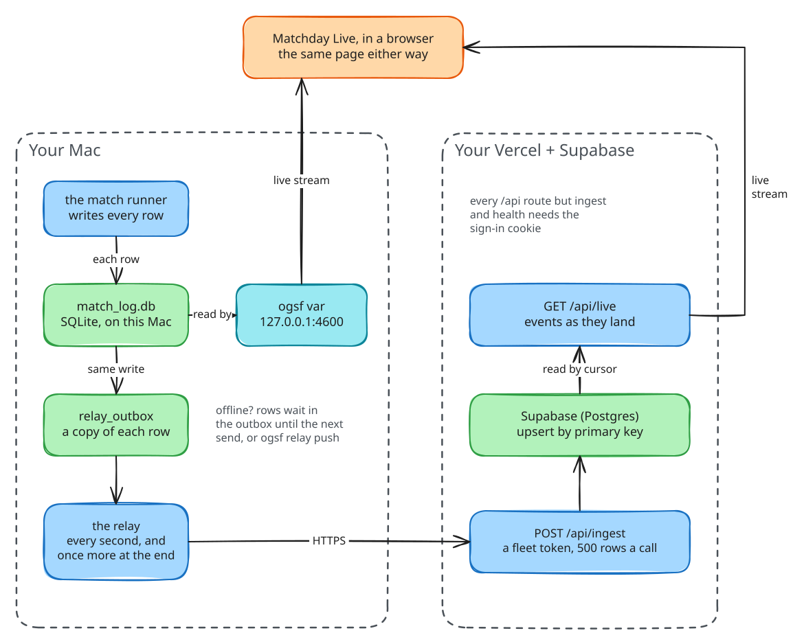

# Matchday Live

Matchday Live is the page where you watch the fleet: every match as it
plays, every player's lane, every tool call, report and review, and the
reports that sum it all up. It is one page that can read from three places,
always through the same API.

## The sections

| Section | Address | What it shows |
|---|---|---|
| Matches | `#/` | every match, newest first, with its objectives as a strip of touchdowns and turnovers |
| A match | `#/m/<match_id>` | the scoreboard, a lane per player, the timeline, the live feed, and each objective's reports, reviews and team talks |
| Daily reports | `#/days`, `#/days/<date>` | one card per day with matches: totals, cost, players, what went wrong |
| Multi-day report | `#/report?from=<date>&to=<date>` | any period, with each player's performance across it; download as PDF or Markdown |
| Upcoming Matches | `#/upcoming` | planned tickets by due time, their status, and the requests queue |
| Docs and Guide | `#/docs`, `#/guide` | these pages |
| Connections | `#/connections` | what the page reads, connecting a Mac, the cloud store and its fleet tokens |

Every address is a hash route, so the page works the same on Vercel,
inside the `ogsf` binary and from a plain file server.

## Where it reads from

Choose on **Connections → What this page reads**:

| Source | Where the data is | Who answers `/api` |
|---|---|---|
| **Demo recording** | a recording bundled with the page | nobody: it is replayed in your browser, as if live |
| **This deployment** | Supabase, or this Mac's match log | the Vercel functions, or `ogsf var` |
| **A fleet at an address** | a Mac running `ogsf var` | that Mac, read directly |

A link can ask for the demo by itself: add `?demo` to the address
(`https://<your app>/?demo`). That is the easiest way to show someone the
fleet without a fleet.

## How a row reaches the page



Read the picture from the match runner down:

1. The engine writes each row to `match_log.db` the moment it happens. When
   a relay is set up, the same write also queues a copy in `relay_outbox`.
2. **Locally**, `ogsf var` reads the file and pushes new rows to the page
   as server-sent events. When the match runs inside the same process, it
   pushes them directly; otherwise it follows the file.
3. **To the cloud**, the relay sends the outbox to `POST /api/ingest` every
   second while a match runs (`var.flush_ms`, default 1000) and once more,
   for up to five seconds, when it ends. The server upserts each row by its
   primary key, in order, so sending a row twice is harmless.
4. **On Vercel**, `GET /api/live` follows Postgres by cursor once a second
   and streams what lands. The cloud closes a stream after about four
   minutes; the browser reconnects by itself and resumes from its cursor.

Because the Mac writes locally first, a match never waits on the network,
and an offline Mac loses nothing: the rows wait in the outbox until the next
send, or until you run `ogsf relay push`.

## The relay

A Mac relays only when its `.env` (or environment) has both:

```sh
CLUB_RELAY_URL=https://<your app>.vercel.app
CLUB_RELAY_TOKEN=<a fleet token minted for this Mac>
```

| Command | Does |
|---|---|
| `ogsf relay status` | is a relay set up, and how many rows wait |
| `ogsf relay push` | send every queued row now |
| `ogsf relay push --all` | queue this Mac's whole match log first, then send it (a backfill) |

A batch is at most 500 rows and 4 MB. Set `CLUB_MACHINE` to change how this
Mac is labelled on the page (the default is its host name).

## Supabase

The cloud store is a Postgres database on Supabase (the free plan is
enough). Its schema is `supabase/migrations/`, and the page applies it for
you from **Connections → Cloud store → Apply the schema**. The API reaches
it through Supabase's transaction pooler (port 6543). It holds the same
tables as a Mac's match log, filled from every Mac you connect, plus the
cloud-only ones: fleet tokens and the requests made on the page.

## Security

Three secrets, set only in Vercel's environment variables:

| Variable | What it is |
|---|---|
| `DATABASE_URL` | Supabase's transaction-pooler connection string |
| `MATCHDAY_PASSWORD` | the password for the page (and for the Claude connector's sign-in) |
| `MATCHDAY_SESSION_SECRET` | 32 or more random characters that sign the sign-in cookie |

Optional:

| Variable | What it is |
|---|---|
| `MATCHDAY_TIMEZONE` | the IANA zone (such as `Europe/London`) the Claude connector cuts report days in when a request does not name one; default UTC. The page itself always uses the viewer's own zone |
| `MATCHDAY_CONNECTOR_REDIRECTS` | extra hosts the connector's sign-in may send a browser back to, comma-separated. Without it: claude.ai, claude.com and localhost only |

- Signing in sets an HttpOnly, Secure, SameSite=Strict cookie for seven
  days. Every `/api` route needs it except `/api/health`, `/api/session`
  (signing in and out) and `/api/ingest` (which takes a fleet token).
- A fleet token is shown once when minted and stored only as a SHA-256
  hash. Revoking it on Connections stops that Mac at its next send.
- The page only ever learns the *names* of the variables and whether each
  is set, never their values.
- The demo needs nothing: it is a recording, replayed in the browser.
- Without `DATABASE_URL`, a deployment still works and plays the demo.

## The demo recording

The recording is made by `ogsf demo` itself: a tour of every set piece,
run through the real engine on the scripted club. So what the demo shows
is what a real fleet looks like, minus the tokens. `make demo-data`
regenerates it.
