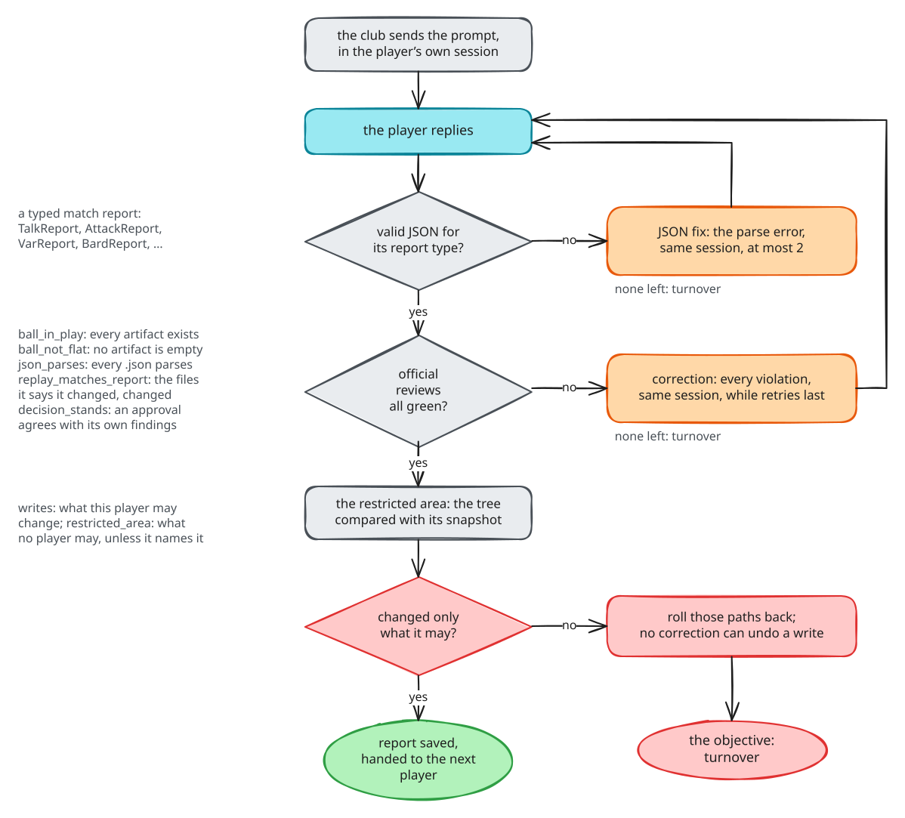

# Players, clubs and match reports

## Players

A player is a role, written down in `club.config.yaml`. One player, one
prompt, one purpose: the playmaker only plans, the builder only builds. A
narrow role is easier to prompt, easier to check, and easier to swap for a
cheaper model when it turns out to be easy.

| Player | Purpose | May change | Report it hands back |
|---|---|---|---|
| playmaker | turn a request into a plan the builder can follow without asking | `specs/` only | `TalkReport` (with a ruling) |
| builder | implement the plan exactly; report every changed file | anything outside the restricted area | `AttackReport` |
| ranger | find and report where things live | nothing | `AnalystReport` |
| safety officer | confirm what was built is what was asked | nothing | `VarReport` (approved or not) |
| bard | write up the change, from the diff | documentation only | `BardReport` |

There is no tester player on purpose. Running a test suite is a known
command, so it is a referee objective over your `qa.checks`, not a model's
job. A model is only asked to *repair* what the suite reports.

### What a player is made of

Each entry under `players:` can set:

| Key | What it does |
|---|---|
| `name` | how set pieces and playbooks refer to it |
| `purpose` | one line; it is also shown on Matchday Live |
| `model` | always `provider/model-id`, such as `anthropic/claude-sonnet-5-5`; a bare name is ambiguous across providers |
| `thinking` | `off`, `minimal`, `low`, `medium`, `high`, `xhigh` or `max` |
| `color` | the player's lane colour on Matchday Live (hex) |
| `tools` | the club's tools it may call: `read`, `bash`, `edit`, `write`, `grep`, `find`, `ls`, plus any an enchantment adds |
| `writes` | what it may change in the repository; leave it out for "anything outside the restricted area" |
| `enchantments` | pi extensions loaded for it, such as the subagent tools |
| `team_talks` | its `system.md` and `user.md` prompt files |

Anything a player leaves out comes from `defaults:`. The shipped defaults
put every player on `anthropic/claude-sonnet-5-5` at `medium` thinking, with
the ranger on `anthropic/claude-haiku-4-5` and the bard on
`openai/gpt-5-mini`; change them to whatever your keys and budget allow.

### Tools are not a sandbox

`tools:` says what a player *can call*. It cannot make "this player changes
nothing" true: `bash` runs anything, including `git checkout`, and `write`
reaches any path. That is why `writes:` exists, and why it is enforced
after every call rather than trusted. See the restricted area in
[safety and checks](safety.md#the-restricted-area).

### Team talks

A *team talk* is what a player is told: `system.md` (who it is, how it
works) and `user.md` (the task shape, with the match report it must hand
back). They live in `set_pieces/clubhouse/team_talks/<player>/`, and the
exact text sent in each match is kept, so Matchday Live can show you
precisely what a player was asked. The project's `club_rules` become a
"Club rules" section in every system prompt.

## Clubs and models

A *club* is the program that runs a player's model. The fleet starts it,
hands it the team talk and reads what it says back; it never calls a model
provider itself and never holds a key.

| Club | What it is |
|---|---|
| `pi` | the real one: the pi coding agent, with your own Anthropic or OpenAI keys from `.env` |
| `scripted` | plays recorded replies instead of a model; the tests and `ogsf demo` use it, so no token is spent |
| `claude_code` | accepted by the config, refused at validation until its driver is written |

Each player keeps **one session per match**. A correction, a JSON fix or a
second objective for the same player goes into the same session, with
everything it already read still in context.

## Match reports

Players hand each other work through *match reports*: typed JSON, never
free text. Every report has the same base, and each type adds its own
fields:

| Report | Extra fields |
|---|---|
| every report | `status` (touchdown or turnover), `summary`, `artifacts`, `notes_for_next_player` |
| `TalkReport` | `commit_message`, `ruling` (`implement`, `noop`, `blocked`), `ruling_reason` |
| `AttackReport` | `changed_files`, `commit_message` |
| `AnalystReport` | `findings: [{file, note}]` |
| `VarReport` | `approved`, `findings: [{requirement, met, evidence}]`, `blocking` |
| `BardReport` | `document_path`, `documented_files`, `commit_message` |
| `GenericReport` | nothing extra |
| `ChangesReport` (built by code) | `base`, `changed_files`, `insertions`, `deletions`, `stat`, `diff_path` |
| `QaReport` (built by code) | `passed`, `failures` |

The next player receives the previous report as its starting point, and
files go through the match's `torch_pass/` folder. That is the whole
hand-over: nothing is passed through a model's memory.

## Official reviews and corrections

A report is a set of claims ("I changed these files", "the plan is at
specs/timer.md"). *Official reviews* are code that checks those claims, one
check per item, so a failure says exactly what was wrong:

| Review | Checks |
|---|---|
| `ball_in_play` | every artifact the report names exists |
| `ball_not_flat` | no named file is empty |
| `json_parses` | every named `.json` file parses |
| `replay_matches_report` | every file the report says it changed did change |
| `decision_stands` | a safety officer's approval agrees with its own findings |
| `tests_pass(cmd)` | a shell command exits 0 |

Every player call goes through three checks, in this order:

1. **Does the reply parse?** If it is not valid JSON for its report type,
   the parse error goes back into the same session, at most twice
   (`JSONFixAttempts = 2`).
2. **Do the official reviews pass?** If not, every violation goes back into
   the same session as one correction ("Your previous response failed
   validation: …"), as many times as the objective allows (usually one).
3. **Did it change only what it may?** If not, those paths are rolled back
   and the objective fails. There is no correction here, on purpose: a write
   has already happened, and asking nicely does not undo it.

Each attempt is recorded, valid or not, so a report on Matchday Live can
count *corrected replies* per player. A player that needs many corrections
is telling you its team talk or its model needs attention.
