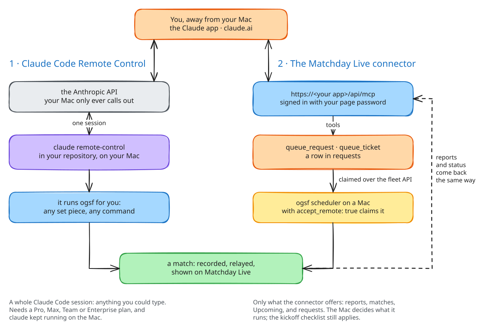

# Remote control

You will not always be at the Mac that runs the fleet. There are two ways
to drive it from the Claude app (on a phone, a tablet or claude.ai), and
they suit different jobs.



## 1 · Claude Code Remote Control

Claude Code's own Remote Control connects the Claude app, or claude.ai/code,
to a Claude Code session **running on your Mac**. The session keeps running
locally the whole time: your files, your shell, the `ogsf` binary and the
OGSF plugin are all there. The app is a window into it.

That makes it the most capable path: anything you could type at the Mac,
you can type from your phone. "Run `ogsf run-heroic` on the timer spec and
tell me when it lands" works, and so does "read the last match's
highlights and tell me why it turned over".

What it needs (from Claude Code's documentation, checked on 2026-10-17):

- A Pro, Max, Team or Enterprise plan, signed in to Claude Code through
  claude.ai (`/login`). API keys are not supported. On Team and Enterprise,
  an Owner must first turn Remote Control on in the Claude Code admin
  settings.
- The Mac stays on and the `claude` process keeps running.
- It is not available through Amazon Bedrock, Google Cloud's Agent
  Platform or Microsoft Foundry, or with `ANTHROPIC_BASE_URL` pointing
  somewhere other than `api.anthropic.com`.

How to start it, in your repository:

| Where | How |
|---|---|
| a terminal, as a server for the app | `claude remote-control` (add `--name "OGSF"` to name the session) |
| a normal session you can also drive remotely | `claude --remote-control` (or `--rc`) |
| a session already running | `/remote-control` (or `/rc`) |

Then open the session URL, scan the QR code it shows, or find the session
by name in the Claude app (tap **Code**) or at claude.ai/code.

Your Mac only makes outbound HTTPS calls; it never opens a port. While a
session is connected, its transcript is stored on Anthropic's servers to
keep your devices in sync; execution and file access stay on your Mac.

## 2 · The Matchday Live connector

Your Matchday Live deployment is also a remote MCP server, at
`https://<your app>/api/mcp`. Add it to the Claude app as a **custom
connector** and you can talk to the fleet without any Mac being on a
Claude Code session.

Its tools:

| Tool | Does |
|---|---|
| `fleet_status` | what is running, the last match, waiting requests, the next tickets, and each Mac with when it was last seen |
| `list_matches` · `get_match` | the matches, and one in full |
| `daily_report` · `multi_day_report` | the reports, in Markdown, with player performance |
| `list_upcoming` | Upcoming Matches and their status |
| `queue_request` · `queue_ticket` | ask a Mac to run a set piece, or a ticket |
| `request_status` · `cancel_request` | follow or cancel a request |

The connector cannot run anything itself. `queue_request` writes a row in
the cloud's requests table; a Mac's Scheduler claims it only if that Mac's
config says `scheduler.accept_remote: true`, and a request by set piece
name runs only if the set piece is in `scheduler.allowed_set_pieces`. The
kickoff checklist still applies. Out of the box no Mac accepts remote
requests at all, and once you turn them on, the default list allows only
the set pieces that commit nothing, plus tickets you wrote yourself. The
Mac, not the phone, has the last word.

Signing in is OAuth 2.1 with PKCE. A client identifies itself by its
Client ID Metadata Document URL (what the Claude app does by default) or by
dynamic registration. The consent page asks for your `MATCHDAY_PASSWORD`,
the same password as the page, and sends the browser back only to
claude.ai, claude.com or localhost; `MATCHDAY_CONNECTOR_REDIRECTS` in Vercel
(comma-separated hosts) allows another.

From Claude Code, the same connector is one command in your repository:

```sh
claude mcp add --transport http matchday https://<your app>/api/mcp
```

then `/mcp` inside Claude Code to sign in.

[Connect the Claude app](guide/claude-app.md) walks through both paths.

## Which one?

| You want to | Use |
|---|---|
| steer real work, read code, fix a failed match | Remote Control |
| check on the fleet, read a report, queue a known kind of job | the connector |
| hand the fleet a sprint and walk away | neither: write tickets and run `ogsf scheduler` ([Upcoming Matches](upcoming.md)) |
