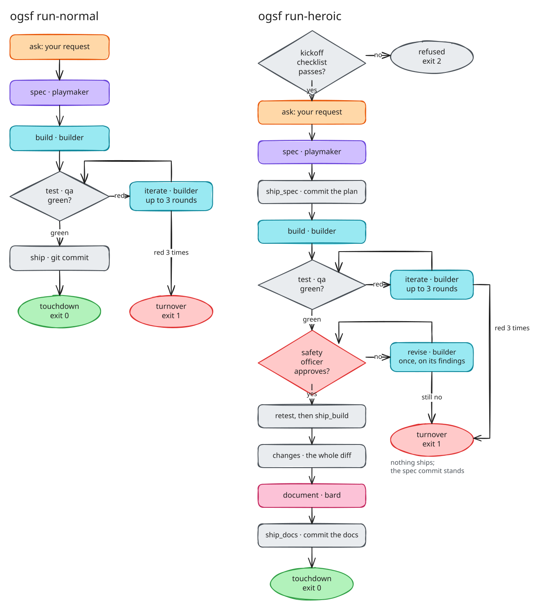
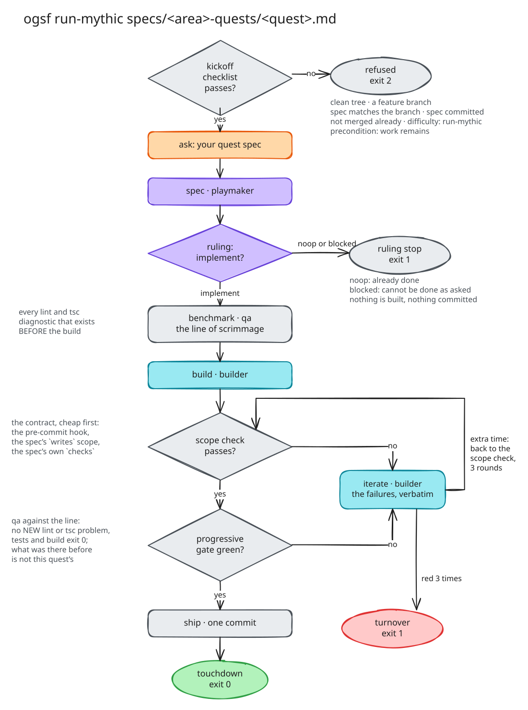

# The set pieces

A set piece is one command that runs one fixed chain of objectives. There
are thirteen. They differ in two ways: **which players take part**, and
**what has to be true before the match is accepted**. Picking one is
mostly a question of how much checking the work deserves.

Every set piece takes a prompt: either the request itself in quotes, or a
path to a Markdown file holding it (`ogsf run-heroic specs/timer.md`).

## All thirteen

| Command | Objectives, in order | Accepted when | Commits |
|---|---|---|---|
| `ogsf ask` | ask → answer (any player, `--player`, default builder) | every objective passes | none |
| `ogsf scout-opposition` | ask → scout_opposition (the ranger, read-only) | every objective passes | none |
| `ogsf team-talk` | ask → spec | every objective passes | none |
| `ogsf attack` | ask → build | every objective passes | none |
| `ogsf talk-attack` | ask → spec → build → ship | every objective passes | one |
| `ogsf attack-var` | ask → build → (test → iterate) up to 3 rounds | the suite is green | none |
| `ogsf attack-review` | ask → build → (review → revise) up to 3 rounds | the safety officer approves | none |
| `ogsf run-normal` | ask → spec → build → (test → iterate) up to 3 → ship | the suite is green | one |
| `ogsf run-heroic` | kickoff → ask → spec → ship_spec → build → tests → review → retest → ship_build → changes → document → ship_docs | green suite and an approval | three |
| `ogsf run-mythic` | kickoff → ask → spec → [ruling stop] → benchmark → build → (scope_check → qa → iterate) up to 3 → ship | contract clean, progressive gate green | one |
| `ogsf bard` | ask → changes → document (`--base`, default `main`) | every objective passes | none |
| `ogsf qa` | ask → qa (every check, strictly) | every check exits 0 | none |
| `ogsf play <playbook>` | ask → each player in your playbook, report to report | every objective passes | none |

"Commits: none" means the set piece leaves its changes in your working tree
for you to read and commit. The four set pieces that ship (`talk-attack`,
`run-normal`, `run-heroic`, `run-mythic`) commit only what passed, and their
commit messages are normalised to Conventional Commits.

## Which one to reach for

**To look, not touch.** `scout-opposition` sends the ranger to find where
things live ("where is auth handled?"). It can read and run commands but
changes nothing in the repository. `ask` is a single question or small task
for any one player; it is the cheapest real match there is, which makes it
the right first match on a new setup.

**To think before building.** `team-talk` stops after the playmaker's spec,
so you can read the plan before anyone writes code. Run it when the request
is fuzzy and you want to see how it was understood.

**To build and decide for yourself.** `attack` builds and stops, leaving the
change uncommitted. `attack-var` adds the test loop: good for "make this
failing test pass". `attack-review` adds the safety officer's review loop
instead: good when *is this what I asked for* matters more than the suite.

**The everyday difficulty.** `run-normal` plans, builds, tests with extra
time and commits only a green result. It is the default for ordinary work
in a repository with a test suite.

**Real work whose shape is not obvious.** `run-heroic` adds the kickoff
checklist, commits the spec first, has the safety officer review the build
(and the builder revise once if needed), retests after a revision, and has
the bard document the change. You get three commits: the spec, the code,
the docs. If the tests or the review never come clean, nothing but the spec
commit lands.

**Large work cut into quests.** `run-mythic` is the strict difficulty, for a
quest with a written spec under `specs/<area>-quests/`. The spec carries a
contract the machine checks. The match can stop at the plan, measures the
lint and type problems that exist *before* the build, and fails only on new
ones. Use it for refactors, lint and type clean-ups, and anything you will
run many times in a row. [Write a quest](guide/your-workflows.md#a-quest-with-a-contract)
shows how.

**After the fact.** `bard` documents the change between `--base` and now.
`qa` runs every check in your config strictly, with no player involved:
handy before a release.

**Your own chain.** `play` runs a *playbook*: a list of players you wrote,
each handed the previous one's report. See
[your own workflows](guide/your-workflows.md).

## run-normal and run-heroic

Colour shows who owns each objective: orange is you, violet the playmaker,
teal the builder, grey plain code, red the safety officer, pink the bard.

A detail that matters when you read a match: a red test run does **not**
fail the test objective. The objective did its job, which was to find out.
The failure becomes a report, the builder gets it word for word in an
`iterate` objective, and the suite runs again. Only running out of extra
time turns the match into a turnover.

## run-mythic

What each stop is for:

- **Kickoff checklist.** A clean tree, a feature branch (never `main`,
  `develop` or `release/*`), a spec that matches the branch name, is
  committed, and has not already merged; then the contract's own checks:
  the difficulty it names is `run-mythic`, and its `precondition` command
  says work remains. Any "no" and the match never starts (exit 2).
- **Ruling stop.** The playmaker is the first to look at the tree, and it
  can say `noop` (already done) or `blocked` (cannot be done as asked).
  Either one ends the match before a token is spent on building. The exit
  is still 1: a dispatched quest that produced nothing is something you
  need to see, not a quiet success.
- **Line of scrimmage.** The `benchmark` objective records every lint and
  type diagnostic that exists before the builder starts. The gate later
  compares against it.
- **Scope check.** Cheap and decisive checks first: the repository's own
  pre-commit hook, the contract's `writes` scope (every changed path must
  match), and the contract's `checks` commands. If any fails, the slow gate
  is skipped for that round and the failure goes straight to the builder.
- **Progressive gate.** Lint and type-check pass if they introduced no
  *new* diagnostic; tests and build must exit 0. See
  [safety and checks](safety.md#qa-and-the-progressive-gate).
- **Re-verifying.** Running `run-mythic` again with the `--match-id` of a
  failed match does not rebuild: it runs the strict gate once on the tree as
  it is now (after your manual repair), with no paid players.

## Flags every set piece takes

| Flag | Meaning |
|---|---|
| `--config <path>` | another club config (default `$CLUB_CONFIG`, then `set_pieces/boardroom/club.config.yaml`) |
| `--match-id <id>` | join or pin a match id instead of minting one |
| `--player <name>` | `ask` only: who answers (default `builder`) |
| `--base <ref>` | `bard` only: what the change is measured against (default `main`) |
| `--skip-kickoff` | `run-heroic` and `run-mythic`: dispatch even when the checklist refuses |

## Exit codes

Every set piece ends with an exit code you can script against:

| Code | Meaning |
|---|---|
| `0` | accepted |
| `1` | not accepted (a review, the suite, the contract or a ruling said no), or an error |
| `2` | the kickoff checklist refused; nothing ran |
| `75` | match abandoned: the model provider failed (no credits, a rate limit, an outage). No review was red; try again later |
| `128+n` | stopped by signal `n` (`130` for Ctrl-C) |
