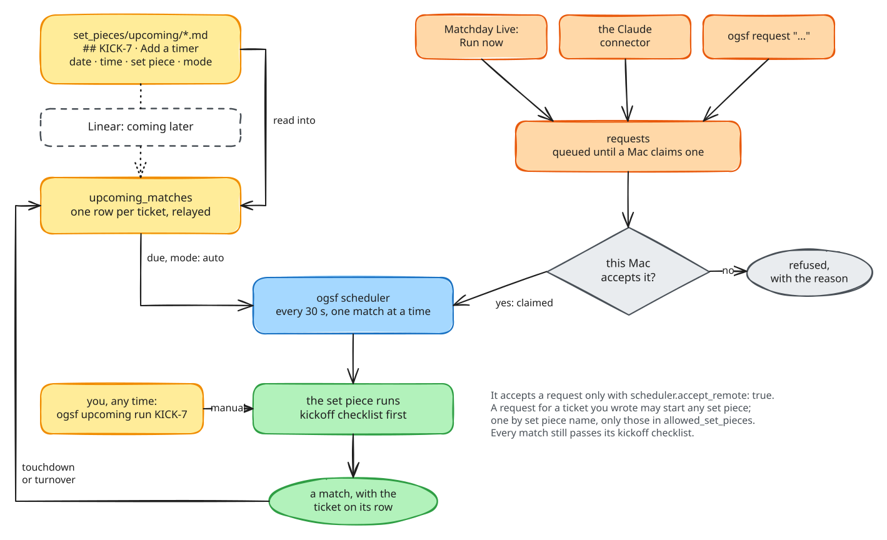

# Upcoming Matches and the Scheduler

Most work is not "run this now". It is a list: this sprint's tickets, each
meant for a day. **Upcoming Matches** is that list, written as Markdown in
your repository. **The Scheduler** is the process that plays it: it starts
each ticket marked `auto` when it is due, one match at a time, and leaves
the `manual` ones for you.



## Tickets

Tickets live in `set_pieces/upcoming/*.md` (`ogsf incorporate` stamps a
`README.md` there with the format). A file can hold a whole sprint:

```md
---
sprint: Sprint 14
timezone: Europe/London
---

# Sprint 14

Anything that is not under a ticket heading is ignored, so notes like
this one are fine.

## KICK-7 · Add a match timer
date: 2026-10-20
time: 09:30
set piece: run-heroic
mode: auto

Add a match timer: start, stop, and minutes played on /timer.
Keep the existing styles.

## KICK-8 · Where is auth handled?
date: 2026-10-20
set piece: scout-opposition

Find where authentication is handled and list the files.

## KICK-9 · Contact form lint quest
date: 2026-10-21
set piece: run-mythic
mode: auto
spec: specs/contact-quests/01-lint.md
```

The rules, which the parser enforces:

| Part | Rule |
|---|---|
| front matter | optional, between `---` lines: `sprint:` and `timezone:` (an IANA zone) |
| heading | `## <ID> · <Title>`: an id like `KICK-7` (letters, a dash, a number), then `·`, `-`, `–`, `—` or `:`, then the title. The id must be unique across every file |
| `date:` | required, `YYYY-MM-DD`: the day it is to be worked |
| `time:` | optional, `HH:MM` (24 h); without it, `upcoming.default_time` applies (default `09:00`) |
| `set piece:` | required: the command it runs (`run-heroic`, `ask`, …) |
| `mode:` | `auto` (the Scheduler starts it when due) or `manual` (the default: a person does) |
| `player:` | `ask` only: who answers |
| `spec:` | a quest spec path, for `run-mythic`; when given it *is* the prompt, and any text under the ticket is ignored. The file must exist: a ticket whose spec is not there yet is marked `skipped` with a note saying so, and is never launched (the kickoff checklist would otherwise read a missing path as plain prompt words); write and commit the spec, then `ogsf upcoming run <id>` |
| `timezone:` | optional, per ticket, overriding the file's and the config's |
| the prompt | after a blank line, everything up to the next `##` heading |

A ticket that cannot be read is listed with the reason, and the others
still load. A ticket keeps its status once it has run: editing a played
ticket does not play it again. Removing a ticket that never ran marks it
`skipped` on the board.

## The config

```yaml
upcoming:
  sources:
    - kind: markdown
      path: set_pieces/upcoming/*.md
    # - kind: linear              # designed for; arrives later
  default_time: "09:00"           # when a ticket with a date and no time is due
  timezone: ""                    # IANA zone for ticket dates; empty = this Mac's

scheduler:
  poll_seconds: 30
  accept_remote: false
  allowed_set_pieces: [ask, scout-opposition, team-talk]
```

`kind: linear` is reserved: the Linear source is designed for and arrives
later. Today it is reported as "arrives later; use markdown for now".

## The commands

| Command | Does |
|---|---|
| `ogsf upcoming` | reads every source and lists the tickets, with their status |
| `ogsf upcoming run <ticket-id>` | plays one ticket now, `auto` or `manual` |
| `ogsf scheduler` | runs until stopped: every `poll_seconds`, and straight after a match, it starts at most one: the earliest due `auto` ticket, then a request made on this Mac, then one from the cloud. Ctrl-C stops it at once; a match in progress gets the same signal and is recorded as a turnover, like any match stopped by a signal |
| `ogsf scheduler --once` | one round, then stops (handy in cron or to test) |
| `ogsf request "<prompt>" --set-piece <name>` | queues a request for this Mac's Scheduler (`--player`, `--machine`, or `--ticket <id>` instead of a prompt) |
| `ogsf requests` | the requests queued on this Mac, newest first |

## Ticket statuses

`scheduled` → `due` → `queued` → `running` → `touchdown` or `turnover`, or
`skipped` with a note saying why. The match that played a ticket carries
its `ticket_id`, so Matchday Live links the two both ways, and the
`upcoming_matches` table is relayed like every other, so the cloud page
shows the same list.

## Requests: "run this now" from elsewhere

A *request* asks a Mac to run something now. It can come from three
places: **Run now** on Matchday Live, the **Claude connector**
(`queue_request`, `queue_ticket`), or `ogsf request` on the Mac itself. A
request made on the cloud page lives in Supabase until a Mac's Scheduler
claims it over the fleet API; one made with `ogsf request` lives in that
Mac's own match log.

Who may start work, exactly:

- An **auto ticket** is started by its Mac's Scheduler when it is due. You
  wrote it, in your own repository.
- A **request** runs only on a Mac whose config says
  `scheduler.accept_remote: true`. Off by default.
- A request **by set piece name** may start only the set pieces in
  `scheduler.allowed_set_pieces`, by default the three that commit nothing:
  `ask`, `scout-opposition` and `team-talk`.
- A request **for a ticket** may start any ticket you wrote, whatever its
  set piece. If the Scheduler already started that ticket by itself (an
  `auto` ticket that came due first), the request takes that match's
  result, with the match id and a note that it was already played; a
  request for a ticket that is still running is refused, with the match id
  in the note.
- **Every match still passes its kickoff checklist.** A refused request is
  marked `refused`, with the reason.

The Scheduler runs one match at a time because a Mac's working tree belongs
to one match: two builders in one checkout would commit each other's work.
